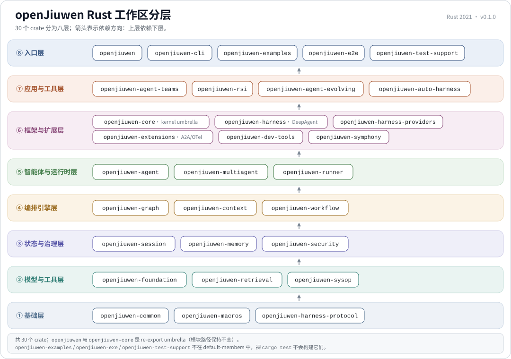
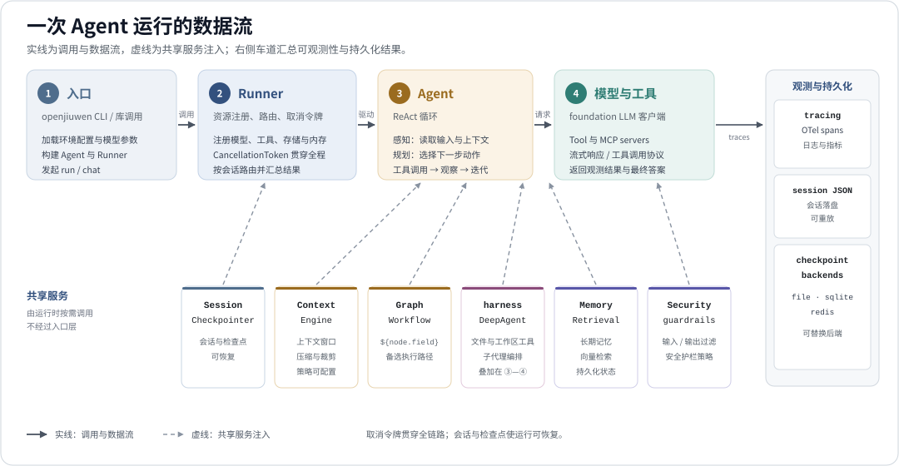

# agent-core-rs

**openJiuwen Agent SDK 的 Rust 重写**：保留 Python 版的模块划分、线格式与持久化契约，内部用 idiomatic Rust（tokio / serde / trait / thiserror）重新实现。

[](https://www.rust-lang.org)
[](LICENSE)
[](#构建测试与门禁)
[](crates/CONTEXT.md)

```bash
cargo run -p openjiuwen-examples --example 01_hello_agent   # 离线、脚本化模型、无需网络
```

---

## 这是什么

本仓库是 [**openJiuwen agent-core**](https://github.com/openJiuwen-ai/agent-core)（Python Agent SDK，v0.1.20）的 **Rust 重写**。
目标不是逐行翻译 Python 实现，而是让同一套公共契约在 Rust 里成立：模块路径、`*Card` 的 JSON 字段、OpenAI / Anthropic 线格式、会话与检查点落盘格式、`${node.field}` 数据引用、`OPENJIUWEN_*` 环境变量链、`openjiuwen` CLI 子命令。

| 项目 | 信息 |
|---|---|
| 原始项目 | openJiuwen agent-core — <https://github.com/openJiuwen-ai/agent-core> |
| 对照版本 | Python SDK `0.1.20`（本地只读参考：commit `455e2a338903c173be34f5453de0290a989ba1e0`） |
| 本仓库 | Rust workspace，30 个 crate，二进制 `openjiuwen` / `team-member` / `openjiuwen-team-mcp` |
| 许可证 | Apache-2.0，见 [LICENSE](LICENSE) |
| 关系 | 独立重写，**不是**上游官方发行物；上游的设计与 Python 实现版权归 openJiuwen 项目及其贡献者 |

**重要：这不是 100% 等价移植。** 已完成的是可运行的子集（kernel、DeepAgent、团队、扩展、开发工具、symphony、RSI、auto-harness、agent-evolving、CLI），未覆盖部分以类型化错误显式返回，完整清单见 [docs/PARITY.md](docs/PARITY.md)。

### 设计目标

- **契约兼容**：模型请求/响应格式、Card 与配置 JSON、会话与检查点、工作流数据流、CLI 行为、环境变量优先级。
- **异步优先**：tokio 运行时；公共流是 `Send + 'static`；取消通过 `tokio_util::sync::CancellationToken`。
- **类型化失败**：库统一使用 `openjiuwen_common::error::{Error, Result}`；未实现能力返回 `Error::Unsupported`，不静默降级。
- **可离线验证**：测试不访问网络、不需要凭据；假 LLM 服务器、脚本化模型、临时目录、loopback socket。

### 非目标

- 不追求 Python 内部结构的逐行等价（不模拟 asyncio 全局状态、pydantic 反射语义）。
- 不重新实现依赖 GPU/ML 栈、厂商 SDK、外部数据库/消息中间件、桌面与移动传输的能力（这些入口保留 API 形状并返回 `Unsupported`）。
- 不提供对上游未来版本的自动跟随；兼容性以 `v0.1.20` 为基准。
- 不承诺 Rust 本身能消除死锁、逻辑漏洞或资源耗尽；安全边界见 [安全与边界](#安全与边界)。

---

## 架构总览



30 个 crate 按依赖方向组织：下层只提供契约与工具，上层组合出 agent 运行时与产品入口。
层号是**语义分组**，不完全等于拓扑深度（`graph → session`、`workflow → graph`、`core → runner`、`openjiuwen → 各 crate`、`cli → openjiuwen` 使最长依赖链达到 13 条边、14 个 crate）；同层内也存在依赖边。

| 层 | Crate | 职责 |
|---|---|---|
| 基础 | `openjiuwen-common`, `openjiuwen-macros`, `openjiuwen-harness-protocol` | 错误与 `ErrorKind`、Card/Config（`schemars`）、`tracing`、环境变量解析、`SecretString`、HTTP 客户端、任务管理；`#[tool]` 宏；harness SPI |
| 模型与工具 | `openjiuwen-foundation`, `openjiuwen-retrieval`, `openjiuwen-sysop` | prompt/message、OpenAI / Anthropic / Responses 客户端、工具与 MCP、存储；切分/嵌入/向量检索；文件、shell、代码、沙箱操作 |
| 状态与治理 | `openjiuwen-session`, `openjiuwen-memory`, `openjiuwen-security` | 会话、流、HITL、checkpointer（file/sqlite/redis）、VCS；长期记忆与 lite memory；guardrails |
| 编排引擎 | `openjiuwen-graph`, `openjiuwen-context`, `openjiuwen-workflow` | Pregel/BSP 图引擎；上下文窗口、压缩与卸载；工作流组件与 `${node.field}` |
| 智能体 | `openjiuwen-agent`, `openjiuwen-multiagent`, `openjiuwen-runner` | `Agent` / ReAct / rails / controller；团队、路由、策略；`Runner`、资源注册、HITL、子进程 spawn |
| 框架与扩展 | `openjiuwen-core`, `openjiuwen-harness`, `openjiuwen-harness-providers`, `openjiuwen-extensions`, `openjiuwen-dev-tools`, `openjiuwen-symphony` | kernel umbrella；DeepAgent 框架；provider 注册表（native/vendor）；A2A、OTel；prompt/skill/agent 构建与调优；能力资产引擎 |
| 应用 | `openjiuwen-agent-teams`, `openjiuwen-rsi`, `openjiuwen-agent-evolving`, `openjiuwen-auto-harness` | 进程内/跨进程团队与 attach；自动 harness 优化与 program/paper 优化；评测与在线 RL；RSI 再导出 |
| 入口 | `openjiuwen`, `openjiuwen-cli` | 顶层 umbrella（`core`/`harness`/… 模块别名 + `prelude`）；`openjiuwen` 二进制 |
| 开发 | `openjiuwen-test-support`, `openjiuwen-e2e`, `openjiuwen-examples` | 假 LLM 服务器与 fixtures；跨 crate 场景；26 个可运行示例 |

两条结构性约定：

- **umbrella 只做 re-export**：`openjiuwen` 与 `openjiuwen-core` 不定义行为；具体 crate 依赖具体 crate，只有框架层及以上才依赖 umbrella。
- **公共类型放在最低公共祖先**：两个 crate 都需要的类型下沉到 `openjiuwen-common` 或 `openjiuwen-foundation`，避免横向依赖。

### 关键抽象

| 抽象 | 位置 | 契约要点 |
|---|---|---|
| `Agent` | `openjiuwen-agent` | `invoke(Value) -> AgentOutput`，`stream` 产出类型化帧；ReAct 循环与 max-iterations |
| `Model` | `openjiuwen-foundation::llm` | provider 自注册到 `ModelProviderRegistry`；未知 provider 是 `Error::Unsupported` |
| `Tool` | `openjiuwen-foundation::tool` | `card()` + `async invoke()` + 默认 `stream()`；`Send + Sync + 'static`，卡片刻画 JSON Schema |
| `Session` / `Checkpointer` | `openjiuwen-session` | 状态补丁、组件状态、流写入、交互请求；检查点可恢复 |
| `Workflow` | `openjiuwen-workflow` | 组件 + 连接 + 条件路由；输入模板用纯 `"${node.field}"` 从运行状态取值 |
| `Runner` | `openjiuwen-runner` | 资源注册与路由、取消令牌、HITL、子进程/团队池 |
| `Harness` / `DeepAgent` | `openjiuwen-harness` | 任务循环、工作区、权限、编码工具、rails、subagent、skills |
| `Error` / `ErrorKind` | `openjiuwen-common` | 18 个 `snake_case` kind；`Unsupported(String)` 携带原因 |

---

## 一次 Agent 运行



1. **入口**：CLI（`openjiuwen run` / `chat`）或库调用构造 `AgentCard` + `ReActAgentConfig`。
2. **Runner**：注册资源、选择模型/工具、建立会话，并把取消令牌传下去。
3. **Agent**：ReAct 循环——模型给出工具调用，工具执行产生观察，直到给出最终答案或达到迭代上限。
4. **模型与工具**：`foundation` 的 provider 客户端（OpenAI 兼容 / Anthropic / Responses）与 `Tool`/MCP 服务；流式输出在协议层被组装为类型化 chunk。
5. **共享服务**：`Session`/`Checkpointer` 负责恢复；`Context` 管理窗口与压缩；`Memory`/`Retrieval` 提供长期记忆与检索；`Security` 做输入/输出护栏；`Graph`/`Workflow` 提供另一种确定性执行路径；`tracing`/OTel 与 session JSON 负责观测与落盘。

---

## 快速开始

**环境要求**：Rust 1.85+（edition 2021）、Cargo；依赖都在 `Cargo.lock` 与本机 registry 缓存中，默认构建与测试不需要网络，也不需要任何模型凭据。

```bash
# 构建全部 crate
cargo build --workspace

# 只编译（含所有 target，比 build 更严格）
make check
```

第一个可运行示例（离线，脚本化模型；除随机 card id 外输出固定）：

```bash
cargo run -p openjiuwen-examples --example 01_hello_agent
```

实际输出（节选）：

```text
  - card: hello-agent (id <random-uuid>)
  - invoking with: What is the capital of France?
note: result type: answer
note: iterations used: 1
answer: Paris is the capital of France.
  - streaming the same question through a second agent
note: stream produced 4 frames
answer: Paris is the capital of France.
```

带工具的 ReAct 回合、工作流、检索、DeepAgent：

```bash
cargo run -p openjiuwen-examples --example 02_react_with_tools   # 工具调用与观察
cargo run -p openjiuwen-examples --example 04_workflow_pipeline  # 条件路由 + ${node.field}
cargo run -p openjiuwen-examples --example 06_retrieval          # 切分→嵌入→向量检索
cargo run -p openjiuwen-examples --example 08_deep_agent         # DeepAgent 在临时工作区写文件
cargo run -p openjiuwen-examples --example 16_memory_lite        # MEMORY.md + FTS5 索引
cargo run -p openjiuwen-examples --example 11_a2a_server_client --features a2a
```

### 接真实模型

示例默认用脚本化模型；切换为真实 provider 需要显式打开开关并给出模型名与凭据：

```bash
export OPENJIUWEN_LIVE=1
export MODEL_NAME=gpt-4o-mini
export OPENJIUWEN_API_KEY=sk-...        # 或 API_KEY / OPENAI_API_KEY
export MODEL_PROVIDER=openai            # 默认 openai
# export API_BASE=https://api.openai.com/v1
cargo run -p openjiuwen-examples --example 01_hello_agent
```

> 注意作用域：`OPENJIUWEN_LIVE` 只被 `openjiuwen-examples` 读取；`OPENJIUWEN_MODEL` / `OPENJIUWEN_PROVIDER` / `OPENJIUWEN_API_BASE` 是 **CLI** 的变量，示例的 live 分支读的是 `MODEL_NAME` / `MODEL_PROVIDER` / `API_BASE`。

### 安装二进制

```bash
cargo install --path crates/openjiuwen-cli           # 安装 `openjiuwen`
cargo install --path crates/openjiuwen-agent-teams   # 安装 `team-member` 与 `openjiuwen-team-mcp`
```

---

## CLI

```bash
cargo run -p openjiuwen-cli -- --version             # openjiuwen 0.1.0
cargo run -p openjiuwen-cli -- run "总结这个仓库" --model gpt-4o-mini --provider openai
```

`run` / `chat` 会真正构建模型，因此需要 provider 凭据；没有凭据时立即失败且不发 HTTP 请求：

```text
error: config: provider `openai` requires an API key; set OPENJIUWEN_API_KEY, API_KEY, or OPENAI_API_KEY (or `api_key`)
```

| 子命令 | 作用 |
|---|---|
| `run [PROMPT]` | 单次运行并退出；支持 `-f text\|json\|stream-json`、`--resume` / `--continue`、`--worktree` |
| `chat` | 交互式 REPL；`--watch` 监听工作区 |
| `sessions` | 列出、查看、清理会话（`list` / `show` / `prune`） |
| `lsp` | 语言服务器查询：诊断、定义、引用、补全、符号、调用层级 |
| `cron` | 查看与操作工作区 cron 计划 |
| `team` | 通过 attach socket 操作另一个进程中的 agent 团队（Unix） |
| `watch` | 监听技能、spec、指令、MCP 重载事件 |
| `auto-harness` | 优化 harness 自身（`run` 的非 dry-run 路径目前返回 `Unsupported`） |

全局选项（可放在子命令前后）：`-m/--model`、`--provider`、`--api-key`、`--api-base`、`-w/--workspace`、`-v/--verbose`、`--no-color`。
退出码：`0` 成功/帮助/版本，`1` 运行期错误（`error: <kind>: <cause>`），`2` clap 用法错误。

---

## 示例（26 个）

全部默认离线：脚本化模型、`HashEmbedding`、内存向量库、临时 SQLite 或 loopback 服务。运行方式 `cargo run -p openjiuwen-examples --example <名称>`。

| # | 示例 | 内容 | 备注 |
|---|---|---|---|
| 01 | `01_hello_agent` | 最小 Agent：`invoke` + `stream` | 支持 live |
| 02 | `02_react_with_tools` | `#[tool]` / `FunctionTool` 工具回合 | 离线 |
| 03 | `03_sessions_and_resume` | 文件检查点、中断与恢复 | 离线 |
| 04 | `04_workflow_pipeline` | 条件边 + `${node.field}` | 离线 |
| 05 | `05_context_and_memory` | 上下文压缩 + 长期记忆 | 离线 |
| 06 | `06_retrieval` | 切分→嵌入→存储→检索 | 离线 |
| 07 | `07_mcp_tool` | MCP 工具挂到 ReAct Agent | 示例内本地客户端 |
| 08 | `08_deep_agent` | DeepAgent 文件工具回合 | 临时工作区 |
| 09 | `09_harness_provider` | `create_harness("native")` 生命周期 | loopback 假 LLM |
| 10 | `10_agent_team` | 团队构建与调用 | loopback |
| 11 | `11_a2a_server_client` | A2A server + client | 需 `--features a2a` |
| 12 | `12_self_improvement` | auto-harness + evolving trainer | 脚本化 |
| 13 | `13_context_processors` | 处理器流水线 | 支持 live |
| 14 | `14_workflow_components` | 子工作流、HTTP 组件、HITL | loopback |
| 15 | `15_retrieval_quality` | BM25、query rewrite、DOCX/XLSX/PDF | 支持 live |
| 16 | `16_memory_lite` | `CodingMemory` / MEMORY.md + FTS5 | 临时 SQLite |
| 17 | `17_team_persistence` | SQLite 团队存储 + org 层 | 临时 SQLite |
| 18 | `18_team_attach` | Unix socket attach server/client | 仅 Unix |
| 19 | `19_symphony_skills` | SKILL.md 发现、检索、注册表、图谱 | 临时文件 |
| 20 | `20_prompt_tuning` | prompt 评分与优化器 | 支持 live |
| 21 | `21_native_tokenizers` | tokenizer.json / tiktoken 与缓存 | 无需下载 |
| 22 | `22_context_telemetry` | 用量与压缩遥测 | 支持 live |
| 23 | `23_memory_dreaming` | dream 队列、合并、退避 | 注入时钟 |
| 24 | `24_runner_spawn_registry` | spawn 注册表、健康检查 | 自身重执行 |
| 25 | `25_harness_moa_persistent` | MoA + 持久 journal 回放 | 临时目录 |
| 26 | `26_online_training_service` | 在线 RL 状态机 | 内存存储 |

完整示例列表与离线/特性开关见 [crates/openjiuwen-examples/CONTEXT.md](crates/openjiuwen-examples/CONTEXT.md)。

---

## 配置

环境变量有优先级链：**CLI 参数 > 环境变量 > `~/.openjiuwen/settings.json` > 默认值**；`.env` 只在 CLI 与示例入口加载。

| 用途 | 变量 |
|---|---|
| 模型凭据（库 + CLI） | `OPENJIUWEN_API_KEY` → `API_KEY` → `OPENAI_API_KEY`；`API_BASE` → `OPENAI_BASE_URL` |
| 模型选择（库） | `MODEL_PROVIDER`（默认 `openai`）、`MODEL_NAME` |
| CLI 专属覆盖 | `OPENJIUWEN_MODEL`、`OPENJIUWEN_PROVIDER`、`OPENJIUWEN_API_BASE`、`OPENJIUWEN_WORKSPACE`、`OPENJIUWEN_MAX_ITERATIONS`（30）、`OPENJIUWEN_MAX_TOKENS`（8192） |
| 示例 | `OPENJIUWEN_LIVE=1`、`OPENJIUWEN_MCP_SERVER_CMD` |
| 日志 | `RUST_LOG`（优先）、`OPENJIUWEN_LOG_LEVEL`、`OPENJIUWEN_LOG_FORMAT`、`NO_COLOR` |
| 会话与工作区 | `OPENJIUWEN_HOME`、`OPENJIUWEN_HISTORY`、`OPENJIUWEN_MCP_CONFIG`、`OPENJIUWEN_NO_ONBOARDING` |
| 团队 | `OPENJIUWEN_TEAM_SOCKET`、`OPENJIUWEN_TEAM_JOIN`、`OPENJIUWEN_TEAM_NAME`、`OPENJIUWEN_MEMBER_NAME` |
| 网络 | `http_proxy` / `https_proxy` / `NO_PROXY`、`SSRF_PROTECT_ENABLED`（默认 true，但当前仅解析、无实际拦截逻辑） |
| 可选后端 | `OPENJIUWEN_REDIS_URL`、`OPENJIUWEN_S3_*`、`OPENJIUWEN_DASHSCOPE_API_KEY`、`OPENJIUWEN_OTEL_*` |

各变量精确读取位置见 [docs/ARCHITECTURE.md §4](docs/ARCHITECTURE.md#4-configuration-and-environment)。

---

## 实现范围与兼容边界

状态含义：**Implemented** = 目标公共面已移植并有测试；**Subset** = 可用核心 + 已命名的缺口；多数缺口以 `Error::Unsupported` 类型化返回（CLI 的 `gap-analyze` 目前只是占位）。

| 领域 | 状态 | 主要缺口 |
|---|---|---|
| kernel（common/foundation 基础、prompt、工具基座） | Implemented | 无 `tool::auth`、`form_handler`；`RestfulApiTool::stream` 类型化未实现 |
| LLM 客户端 | Subset | `output_parsers`、`system_one`、request sanitizer、TPM/RPM 强制；Responses 的后台模式与托管工具 |
| MCP / 外部存储 | Subset | Playwright transport、真正的 `resources/subscribe` 推送；PostgreSQL/Milvus/Chroma/ES 等外部后端类型化未实现 |
| graph / workflow | Implemented / Subset | 工作流 PNG 绘制、`StreamDelivery::Interleaved`、分支 OR 合并未实现 |
| context / memory / retrieval | Subset | 官方 provider tokenizer、分布式 KV 锁、托管向量库与 OCR、加密 PDF |
| sysop / security | Subset | 容器运行时启动器、流式 sandbox 线协议；本地模型护栏后端 |
| agent / multiagent / runner | Subset / Implemented | 分布式模式（drunner/Pulsar/ZeroMQ）、跨进程 HITL 强制、`python -m` 启动 |
| DeepAgent harness / providers | Subset | browser/cua/mobile 预设、部分 context fetcher、OTLP exporter、vendor fork 模式 |
| agent-teams | Subset | ZeroMQ/WebSocket/Pulsar 传输、PG/MySQL 存储、monitor TUI、跨进程 org 联邦 |
| extensions / dev-tools / symphony / rsi / agent-evolving | Subset | A2A gRPC、OTLP/gRPC、Pulsar、本地模型 judge、FAISS/GPU 训练与评测流水线 |
| CLI | Implemented | 非 dry-run `auto-harness run`、`verify-ext`、`gap-analyze` |

### 兼容契约（保持兼容的部分）

- **线格式**：OpenAI Chat Completions（含 SSE `data:`/`[DONE]`）、Anthropic Messages（含 tool 块与流式事件）、OpenAI Responses 传输。
- **JSON 形状**：`*Card` 字段名与默认值（`snake_case`，未知字段容忍）；`CardBase` 省略未设置项，`AgentCard`/`WorkflowCard` 按 Python 行为写出 `null`。
- **工作流**：`${node.field}` 引用与数组/索引投影；缺失路径解析为 `null` 而不是失败。
- **持久化**：会话 `sessions.json`、文件/SQLite/Redis 检查点、工作流状态存储的键与命名空间。
- **环境变量与 CLI**：上述优先级链、子命令与退出码。
- **错误**：网络与校验错误保留 `ErrorKind` 语义；凭据在日志中被脱敏。

### 已知差异（有意为之）

- `AgentOutput.output` 是字符串，结构化负载放在 `data` / `workflow_output`，不复刻 Python 的嵌套 dict。
- 并发模型用 tokio 任务替代 asyncio task group；任务管理器在 drop 时取消遗留任务。
- 确定性优先：id 显式或 UUID，注册表/订阅者顺序稳定，测试不依赖墙上时钟。
- Rust 侧新增而 Python 无对应物：`multiagent::{routing, inbox}`、`extensions::observability`、`TokenizerArtifactManager`、Redis Streams 团队传输、`mcp_resource_subscription` 工具、确定性 SVG 渲染。

---

## 未实现与 Deferred

未实现能力按原因分类，并在代码中以 `Error::Unsupported` 暴露：

| 原因类别 | 例子 |
|---|---|
| 外部服务 / broker | Milvus/Chroma/PGVector 向量库、Pulsar 传输、分布式 KV 锁 |
| 厂商 SDK | `claudecode` / `codex` / `dsh` provider 的深度集成、GCS/Azure 鉴权 |
| GPU / ML 栈 | PPO/verl/ray 训练、FAISS/sentence-transformers 索引、本地模型护栏 |
| 平台自动化 | 浏览器/桌面/移动预设、Docker/WSL 评测容器 |
| 格式 / 设计不兼容 | Python pickle 之外的对象图、A2A gRPC |

```rust
// 形状示例：能力不可用时返回类型化错误，而不是空实现
Err(Error::unsupported("unavailable vector store provider: milvus"))
```

可执行的证据：`openjiuwen-dev-tools/tests/deferred_surface.rs`、`openjiuwen-symphony/tests/deferred.rs`、`openjiuwen-agent-evolving/tests/rl.rs`、`openjiuwen-sysop/tests/sandbox_stub.rs` 等直接断言错误消息。
全量清单见 [docs/PARITY.md §Deferred Features](docs/PARITY.md#deferred-features)；按 `Error::unsupported(`/`Error::Unsupported(` 构造点粗计，生产代码约 260 处 `Unsupported`。

---

## 构建、测试与门禁

```bash
make build       # cargo build --workspace
make test        # cargo test --workspace --offline --no-fail-fast
make fmt-check   # cargo fmt --all -- --check
make clippy      # cargo clippy --workspace --all-targets -- -D warnings
make doc         # RUSTDOCFLAGS="-D warnings" cargo doc --workspace --no-deps
make test-all    # 7 组特性门禁（a2a / otel / sqlite / sandbox / vendor / no-default-features）
make examples    # 编译全部示例（含 a2a、mcp 特性组）
make verify      # fmt-check + clippy + test + doc + test-all + 示例构建
```

- **`default-members` 陷阱**：直接运行 `cargo test` 只覆盖 27 个库/二进制 crate；`openjiuwen-e2e`、`openjiuwen-examples`、`openjiuwen-test-support` 需要 `--workspace` 或 `-p`。
- **测试是封闭的**：无网络、无凭据、无墙上时钟依赖；服务器绑定 `127.0.0.1:0`，模型为脚本化或假服务器，存储在内存或 `tempfile` 目录。
- **`#[ignore]` 只有 5 个**：3 个是被父测试重新执行为 stdio 协议子进程的桩，1 个是需要真实 sandbox 网关的探测，1 个是 e2e 侧的 `openjiuwen` 二进制探测；它们都不是被跳过的功能测试。
- **特性开关**：`foundation` 默认启用 `mcp` 与 `tiktoken`；`harness`/`harness-providers` 默认 `native`；`sqlite`、`a2a`、`otel`、`sandbox`、`vendor`、`redis`、`pulsar` 均为可选。`live-tests` 是空标记特性（不 gate 任何代码），真实模型只由 `OPENJIUWEN_LIVE=1` 开启。
- **离线**：`Cargo.lock` 中的依赖已在本地 registry 缓存，`make test` 全程 `--offline`。

---

## 性能

单机对照测量（同一台 8 逻辑核 / 23 GiB 机器，warm page cache，无网络；Rust release `lto=thin, codegen-units=1`，CPython 3.11.15）：

| 指标 | Rust | Python 3.11 | 说明 |
|---|---|---|---|
| 进程启动且 SDK 类型可达 | **1.20 ms**，峰值 **3.60 MiB** | — | Rust 专属下界（最小二进制），不与 Python 相除 |
| 完整 CLI（`openjiuwen --version`） | 2.45 ms，8.82 MiB | — | 无对等 Python 语义 |
| 一次脚本化 Agent 回合（含进程启动） | 2.85 ms，8.55 MiB | 未测 | Python 参考无内置脚本化模型 |
| `import openjiuwen` | — | **51.60 ms**，19.96 MiB | 仅并列展示，不做倍数结论 |
| prompt 模板渲染 | **0.356 µs/次**（2.81 M/s） | 16.37 µs/次（61.1 k/s） | 同语义 → 约 **46×** |
| 2 节点图执行 | **7.23 µs/次**（138 k/s） | 112.3 µs/次（8.9 k/s） | 同语义 → 约 **15×** |

限制：只测 warm page cache（无 root 无法清缓存）；进程级每行 20 个新进程，两个纯本地操作各 30 次重复（丢弃前 3 次）取中位数、另报 p95，两侧 batch 大小不同（Rust 10×）按每次操作归一；未测 LLM/网络延迟、并发扩展、Python 侧 agent 回合；图执行比较的是逻辑形状而非同一引擎。
完整方法、逐次原始样本与复现命令见 [docs/BENCHMARKS.md](docs/BENCHMARKS.md)。

---

## 代码规模

| 分类 | 文件数 | 行数 | 说明 |
|---|---:|---:|---|
| 生产代码（路径含 `/src/`，去掉文件内 `#[cfg(test)]` 之后的部分） | 2,314 | 803,046 | `crates/*/src`（2,313）+ `docs/bench/rust/src`（1） |
| 内嵌单元测试（`#[cfg(test)]` 模块） | — | 324,292 | 与实现同文件 |
| 集成测试（`crates/*/tests`） | 593 | 295,499 | 一个文件一个测试二进制（含嵌套目录） |
| 示例（`examples/`） | 27 | 11,930 | 26 个示例 + 共享 `common` |
| **合计（git 跟踪的 `.rs`）** | **2,934** | **1,434,767** | `tokei` 计 1,098,785 行代码（排除空行与注释） |

统计口径与复现命令见 [docs/REWRITE_APPENDIX.md](docs/REWRITE_APPENDIX.md)。
测试代码约占全部 Rust 行的 **43%**（内嵌测试 + 集成测试）。测试规模：24,293 个 `#[test]` / `#[tokio::test]` 函数，30 个 crate，26 个示例。

---

## 目录结构

```text
.
├── Cargo.toml                 # workspace：30 个成员、共享依赖与 lint
├── Makefile                   # build / test / test-all / clippy / doc / examples / verify
├── LICENSE                    # Apache-2.0
├── README.md                  # 本文件
├── REPORT.md                  # Rust 重写总结报告（约两页）
├── crates/
│   ├── openjiuwen-common/     # 错误、Card、日志、env、HTTP（层 0）
│   ├── openjiuwen-foundation/ # prompt、LLM、工具、MCP、存储
│   ├── openjiuwen-session/    # 会话、检查点
│   ├── openjiuwen-graph/      # 图引擎
│   ├── openjiuwen-workflow/   # 工作流与 ${node.field}
│   ├── openjiuwen-context/    # 上下文引擎
│   ├── openjiuwen-memory/     # 记忆
│   ├── openjiuwen-retrieval/  # 检索
│   ├── openjiuwen-sysop/      # 文件/shell/沙箱
│   ├── openjiuwen-security/   # 护栏
│   ├── openjiuwen-agent/      # Agent、ReAct、rails
│   ├── openjiuwen-multiagent/ # 团队原语
│   ├── openjiuwen-runner/     # Runner、HITL、spawn
│   ├── openjiuwen-core/       # kernel umbrella（17 个模块别名）
│   ├── openjiuwen-harness*/   # DeepAgent 框架 / SPI / providers
│   ├── openjiuwen-agent-teams/# 团队运行时 + team-member / team MCP
│   ├── openjiuwen-extensions/ # A2A、OTel、存储适配
│   ├── openjiuwen-dev-tools/  # prompt/skill/agent 构建与调优
│   ├── openjiuwen-symphony/   # 能力资产引擎
│   ├── openjiuwen-rsi/        # auto-harness / program_opt
│   ├── openjiuwen-agent-evolving/ # 评测、在线 RL
│   ├── openjiuwen-auto-harness/   # RSI 再导出
│   ├── openjiuwen/            # 顶层 umbrella + prelude
│   ├── openjiuwen-cli/        # `openjiuwen` 二进制
│   ├── openjiuwen-e2e/        # 跨 crate 场景
│   ├── openjiuwen-examples/   # 26 个示例 + 共享 harness
│   └── openjiuwen-test-support/   # 假 LLM 服务器、fixtures
└── docs/
    ├── ARCHITECTURE.md        # 分层、共享契约、异步模型、配置、特性、测试、移植方法
    ├── PARITY.md              # Python → Rust 矩阵、兼容边界、deferred、验证
    ├── BENCHMARKS.md          # 性能测量方法与原始结果
    ├── REWRITE_APPENDIX.md    # 重写统计口径、历史数据、复现命令
    └── assets/                # README 使用的 SVG 图
```

每个 crate 与关键子目录都有自己的 `CONTEXT.md`（Intent / API Surface / Constraints / Routing Table），是路由与 API 的第一手来源。

---

## 文档索引

| 文档 | 内容 |
|---|---|
| [docs/ARCHITECTURE.md](docs/ARCHITECTURE.md) | crate 分层、共享契约、异步与流模型、配置、特性开关、测试基础设施 |
| [docs/PARITY.md](docs/PARITY.md) | 逐 Python 包的状态矩阵、线格式兼容、deferred 清单、验证门禁 |
| [docs/BENCHMARKS.md](docs/BENCHMARKS.md) | 性能测量环境、命令、原始样本、限制 |
| [docs/REWRITE_APPENDIX.md](docs/REWRITE_APPENDIX.md) | 统计口径、历史任务数据、复现命令 |
| [REPORT.md](REPORT.md) | 重写总结（范围、规模、成本、性能、收益与限制） |
| 各 crate `CONTEXT.md` | 该目录的意图、API、约束与子目录路由 |

---

## 安全与边界

- **自有代码无 `unsafe`**：workspace lint 为 `unsafe_code = "deny"`，grep 结果为 0 个 `unsafe` 块/函数、0 个 `extern "C"`。
- **边界是真实存在的**：SQLite 经由 `sqlx` → `libsqlite3-sys`（内置 C 源码）、`nix`/`libc`（PTY、flock、信号）、`ring`（汇编）、`inotify`（文件监听）；还会启动子进程（`/bin/sh`、`git`、LSP server、MCP stdio、`docker`、`team-member`）。
- **类型化错误与取消**：`ErrorKind` 18 个变体，`CancellationToken` 贯穿 runner/agent/tool；但 Rust 不保证无死锁、无逻辑漏洞或资源不耗尽。
- **不提供沙箱隔离承诺**：sysop 的 sandbox 是可选 HTTP 网关；容器运行时启动器未实现。运行不可信代码前请自行隔离。
- **凭据**：`SecretString` + 日志脱敏；HTTP 错误消息经 `redact_credentials`。`SSRF_PROTECT_ENABLED` 目前只解析、未接入拦截。

---

## 许可证与致谢

本项目以 **Apache License 2.0** 发布，全文见 [LICENSE](LICENSE)。

- 原始项目：[openJiuwen agent-core](https://github.com/openJiuwen-ai/agent-core)（Python SDK v0.1.20，Apache-2.0）。
- 本仓库保留其公共模块划分、JSON 契约与线格式；Rust 实现、Rust 专属扩展与测试由本仓库维护者与多智能体迁移流程产出。
- 感谢 openJiuwen 项目及所有上游贡献者。

## 项目状态

- 30 个 crate 全部 `publish = false`，版本 `0.1.0`，未发布到 crates.io。
- 无 CI 配置：`Makefile` 是唯一门禁入口；请在提交前运行 `make verify`。
- 这是可用但非完整的重写：可离线运行、可接真实模型、覆盖主要编程 agent 场景；分布式模式、GPU/ML 栈与厂商深度集成仍为 deferred。
