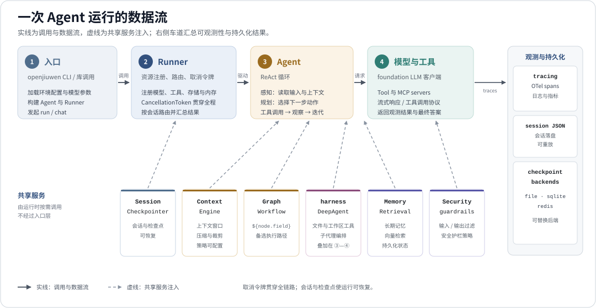

# 从 Python 到 Rust：openJiuwen 智能体平台重写成果

> **执行摘要｜已形成覆盖核心运行链路的 Rust 交付底座，具备轻量部署与本地执行效率优势；下一步价值在于场景试点，而非宣称全面替代。**

本项目基于 [openJiuwen agent-core](https://github.com/openJiuwen-ai/agent-core)（Python SDK v0.1.20）独立重写：不是逐行翻译，而是保留模型接口、数据格式与工作流契约，用 Rust 重新组织智能体基础设施。已交付可运行、可离线验证的主要能力子集，**不是上游官方发行物，也不是 100% 等价移植**。

## 一、投入与产出：两次有效任务，形成完整交付底座

| **记录费用** | **累计 Agent 实例** | **任务墙钟合计** | **历史提交** |
|:---:|:---:|:---:|:---:|
| **$150.02** | **3,570** | **113 小时 42 分** | **3,765 次** |
| 模型调用费用 | 非人数、非峰值并发 | 含等待与排队，非人工工时 | 含合并提交，不含初始空提交 |

两次有效任务分别完成主体重写与后续演进；首次虽由用户中断，成果有效。费用精确值为 **$150.024283**，不含机器、人工等成本。提交按两次历史结果边界去重计数（首次 3,625 次、后续 140 次），**不混入后续文档任务**。上述指标反映自动化交付投入，不能直接换算为节省的人月。¹

| **交付结构** | **代码规模** | **测试资产** | **可体验成果** |
|:---:|:---:|:---:|:---:|
| **30 个 crate（模块包）** | **143.5 万物理行** | **24,293 个测试函数** | **26 个可运行示例** |
| 分层工作区 | 其中生产代码约 80.3 万行 | 测试代码约占 43% | 默认离线、无需模型凭据 |

规模为现有源码统计，包含测试、注释与空行，不是两次任务快照相加；Python 参考仓库含测试约 143.6 万物理行，**不以行数证明压缩率或质量**。

## 二、交付能力：从模型接入到协作执行

| 能力板块 | 已交付的主要能力 | 对应用的意义 |
|---|---|---|
| **模型与知识** | OpenAI / Anthropic / Responses 客户端，提示词、工具与 MCP，记忆与检索 | 复用模型与工具生态，减少重复接入 |
| **运行与编排** | Agent / ReAct、图与工作流、上下文管理、会话与检查点、护栏 | 支持多步任务、状态恢复与执行治理 |
| **编程与协作** | DeepAgent 任务循环、工作区与权限、20 个内置工具、子智能体与技能、进程内团队及跨进程接入 | 覆盖主要编程 Agent 与团队协作链路 |
| **应用与扩展** | CLI、A2A / OTel、开发工具、symphony、RSI / auto-harness、agent-evolving 核心 | 提供观测、评测与优化的可用子集 |

### 架构价值：共享底座，而不是单个演示程序

复用 README 运行图：入口统一接入，运行时调度智能体，智能体组合模型与工具；会话、上下文、记忆与治理作为共享服务。30 个模块按依赖方向分层，模型、工具、会话可独立替换；公共类型集中、异步执行与取消机制统一，降低跨模块集成和后续维护的不确定性。兼容重点是外部契约，而非 Python 内部实现。

## 三、业务价值：更轻的运行载体，更低的本地执行开销

- **部署更集中**：CLI 约 34 MB，交付为单一二进制（仍动态链接 glibc），适合 CLI、CI 与短生命周期工具；不等于无外部依赖。
- **本地执行更高效**：可比微基准显示提示词渲染与简单图执行明显提速，为高频编排提供余量；不代表模型推理或端到端任务同幅提速。
- **治理更显式**：类型约束、统一错误、取消机制与凭据脱敏提高可审计性；自有代码禁用 `unsafe`，有助于降低内存安全风险，但不保证没有逻辑漏洞、死锁或权限错误，依赖与子进程仍需治理，也不构成沙箱隔离承诺。

| 同机本地微基准（每次操作中位数） | Rust | Python | 可支持的结论 |
|---|---:|---:|---|
| 提示词模板渲染 | 0.356 µs | 16.37 µs | 被测同语义操作约 **46×** |
| 两节点图执行 | 7.23 µs | 112.3 µs | 被测同逻辑形状约 **15×**，非同一引擎 |

**内存与启动仅作独立观测**：Rust 最小程序（SDK 类型可达）为 **1.20 ms / 3.60 MiB 峰值 RSS**；脚本化 Agent 回合（含启动）为 **2.85 ms / 8.55 MiB**。Python 仅导入 SDK 为 **51.60 ms / 19.96 MiB**。三者工作量不同，且无 Python Agent 回合对照，**不计算启动或内存优势倍数**。

测量采用同机、热页缓存、无网络环境，Rust release 对照 CPython 3.11；未覆盖冷启动、真实模型网络延迟与并发扩展，不能外推为“整个平台快 15–46 倍”。

## 四、成熟度判断：可进入试点，仍需按场景验收

**验证基础已具备**：既有记录显示，30 个模块的全工作区离线测试、格式与静态检查、文档、7 组特性门禁及示例构建通过；此前另有 CLI、无凭据错误路径、代表性示例及 common / CLI 定向测试验证。**24,293 是测试函数存量，不是本轮执行数**；本轮仅改摘要、核对数据与链接，未重新编译或运行测试。离线验证也不等于所有真实模型与外部服务已验收。

**决策建议**：优先选择编程助手、CLI 自动化或本地工作流做受控试点，以业务成功率、真实模型成本与部署资源验收。分布式运行、GPU/ML 栈及部分厂商/外部系统适配仍在范围之外，未实现路径显式返回不支持；目前无 CI、尚未正式发布，规模化推广前需补齐持续验收与版本维护机制。

---

¹ 另有一次租约失效任务，无结果提交且用量未记录，未计入；未知不等于零，因此 $150.02 不是账户总消耗。当前及后续文档整理均不计入历史投入。

**详见**：[项目与架构](README.md) · [统计与历史口径](docs/REWRITE_APPENDIX.md) · [性能测量及限制](docs/BENCHMARKS.md) · [覆盖范围与验证记录](docs/PARITY.md)
